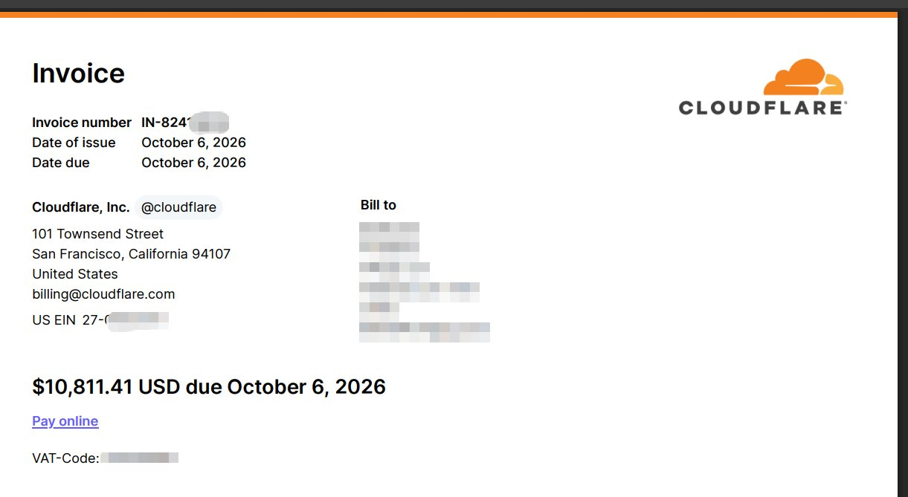

# Une alarme Durable Object à 10 811 $

2026-10-10&emsp;Incident&emsp;<a href="./">Tous les articles</a>

Le 6 octobre, un développeur qui publie sous le nom de [浮世绘 (@shmily7)](https://x.com/shmily7) a partagé une facture Cloudflare de **10 811,41 $**. La cause, selon ses mots : une alarme Durable Object prise dans une boucle infinie, avalant environ six mille milliards de lectures et d'écritures. Le projet lui-même n'était qu'un prototype de recherche inactif que personne n'utilisait. [Le fil](https://x.com/shmily7/status/2108060782302990699) a attiré des centaines de milliers de vues, et pas mal de développeurs sont discrètement allés vérifier leurs propres tableaux de bord.

La facture, telle que publiée par <a href="https://x.com/shmily7">@shmily7</a>, les détails de facturation ayant été floutés par son auteur.

L'histoire s'est bien terminée, donc commençons par là : Cloudflare a accepté de rembourser les frais. Pourtant, la façon dont c'est arrivé est assez courante pour valoir la peine d'être démontée.

## Ce qui s'est passé

- **Le bug est resté 23 jours.** Il est entré pendant le développement, puis est resté dormant, jusqu'à ce que l'alarme commence à se reprogrammer elle-même. Comme rien n'échouait, il n'y a eu ni erreur ni avertissement : chaque exécution a réussi et a été facturée.
- **La facture a été le premier signal.** Cloudflare l'a émise le 6 octobre, exigible le jour même.
- **Ils l'ont payée.** Une demande de support pour une dérogation exceptionnelle s'est heurtée à des réponses automatiques, et des e-mails avertissant que les services du compte seraient suspendus continuaient d'arriver, alors le 8 octobre ils ont payé en totalité. À ceux qui leur demandaient dans les réponses pourquoi ils ne partaient pas simplement, ils ont répondu (notre traduction) : *on fait une erreur, on l'assume — on encaisse debout.*
- **Puis Cloudflare est intervenu.** Ashley Peacock a pris l'affaire en interne, le CTO de Cloudflare l'a fait remonter, et le 9 octobre Cloudflare a décidé de rembourser tout ce qui avait été facturé pendant le bug, accompagné d'un compte rendu détaillé de ce qui avait mal tourné.

{.portrait}

Le paiement du solde le 8 octobre. Publié par <a href="https://x.com/shmily7">@shmily7</a> ; nous avons retiré le numéro de facture et les quatre derniers chiffres de la carte.

Ils n'étaient pas seuls. D'autres développeurs dans les réponses ont mentionné des factures allant de 1 000 à 10 000 $, chacune déclenchée par une boucle ou une routine d'interrogation passée inaperçue.

## Pourquoi rien n'a prévenu personne

Trois choses se sont alignées ici.

**La facturation n'a pas de frein.** Sur un plan payant, un Durable Object facture par requête, par unité de durée et par ligne lue et écrite. Une boucle ne plante pas ; elle continue simplement de facturer, et rien n'arrête un compte à l'usage à une limite de dépense. Une réponse notait que Cloudflare a annoncé des plafonds de dépense, avec un aperçu attendu avant la fin de l'année. En attendant, le plafond est celui que la carte acceptera.

**Une alarme peut se programmer elle-même.** La façon standard de gérer un travail périodique dans un Durable Object est un gestionnaire `alarm()` qui exécute sa tâche puis appelle `setAlarm()` pour l'exécution suivante. Si le calcul de ce prochain moment tombe dans le passé ou maintenant, le gestionnaire se déclenche immédiatement à nouveau et continue, lisant et écrivant le stockage à chaque passe.

**Personne ne regardait.** Un projet sans utilisateurs n'a pas de graphiques de trafic que quelqu'un consulte, ni de journaux d'erreurs à examiner, et cette boucle n'a jamais levé d'erreur. Sans yeux humains dessus, un usage élevé ne devient jamais un avertissement de lui-même.

Les deux premiers points sont à changer chez Cloudflare et à prévenir côté développeur. Le troisième est là où l'outillage peut aider.

## Ce qu'un grand livre quotidien aurait montré

CloudBridge récupère chaque jour l'usage facturable de Cloudflare et, quand on lui donne Account Analytics sur le jeton, répartit les lignes Durable Objects entre les espaces de noms. Il vaut la peine d'être précis sur ce que cela aurait fait et n'aurait pas fait dans ce cas.

- **Il aurait eu la boucle le lendemain.** Les lignes de lectures et d'écritures de l'espace de noms arrivent quotidiennement dans le grand livre, y compris la part couverte par la franchise gratuite à un coût de zéro, qui est là où une boucle commence.
- **La règle d'anomalie serait restée silencieuse.** Elle évalue chaque service par rapport à ses sept jours précédents, et un projet qui ne coûtait rien a une base de zéro. Nous évitons délibérément de signaler une première apparition comme une « croissance » : la plupart des nouvelles dépenses sont simplement une charge de travail nouvelle plutôt qu'un emballement. Ici, c'était le mauvais résultat, et c'est une lacune connue de notre logique.
- **Une règle de budget prévisionnel se serait déclenchée au premier rafraîchissement.** La prévision de fin de mois fait la moyenne de la dépense à partir du premier jour où il y a eu des frais, et projette ce rythme sur le reste du mois. Pour donner des chiffres : une boucle facturant 300 $ le premier jour, avec 20 jours restants, se projette à plus de 6 000 $. Face à un budget mensuel modeste de 20 $, cette règle se déclenche au premier rafraîchissement qui lit la journée.
- **Cela n'aurait rien arrêté.** CloudBridge lit les factures avec un jeton en lecture seule. Il ne peut pas mettre un Worker en pause, et il ne devrait pas en avoir le pouvoir. Ce qui change, c'est votre délai : vous l'apprenez dans un intervalle de rafraîchissement (aussi court que six heures) après que Cloudflare a rapporté la journée, au lieu d'attendre l'arrivée de la facture.

La mise en place prend environ une minute par compte : définissez un budget mensuel, ajoutez une règle Budget de compte basée sur la prévision de fin de mois, choisissez un intervalle de rafraîchissement de 6 heures, et gardez l'application ouverte dans la barre des menus. [Repérer un emballement](https://cloudbridge.jetsquirrel.cloud/docs/cloudflare#runaway) détaille les étapes. Cela vaut la peine pour les comptes silencieux aussi, parce que ce sont précisément ceux que personne ne surveille.

## Protéger l'alarme elle-même

Un avertissement raccourcit un emballement ; il ne l'empêche pas. À l'intérieur du Durable Object lui-même :

- **Réarmez exprès.** Faites en sorte que `alarm()` n'appelle `setAlarm()` que s'il reste du travail, et calculez le prochain moment à partir de maintenant avec un plancher, pour qu'il ne puisse jamais être programmé dans le passé.
- **Comptez les exécutions.** Tenez un compteur dans le stockage par heure ou par jour. Une fois qu'il dépasse un plafond qu'aucune charge de travail réelle ne devrait atteindre, arrêtez le réarmement et journalisez-le bruyamment.
- **Effacez les alarmes quand c'est inactif.** Appelez `deleteAlarm()` chaque fois qu'un objet n'a plus rien à faire.
- **Démontez ce que personne n'utilise.** Un prototype déployé est toujours lié à un compte de facturation actif. S'il n'est pas nécessaire ce mois-ci, supprimez le Worker.

## La suite

Les notes de version 0.5.0 disaient que les constats Cloudflare commenceraient par les espaces de noms Durable Object dont les objets gardent des alarmes programmées. C'est exactement le cas qu'elles sont censées attraper. L'angle mort de la règle d'anomalie pour une dépense partant de zéro est une lacune connue ; en attendant qu'elle soit comblée, la règle de budget la couvre.

Merci à l'auteur du fil d'avoir raconté toute l'histoire en public, remboursement compris.
