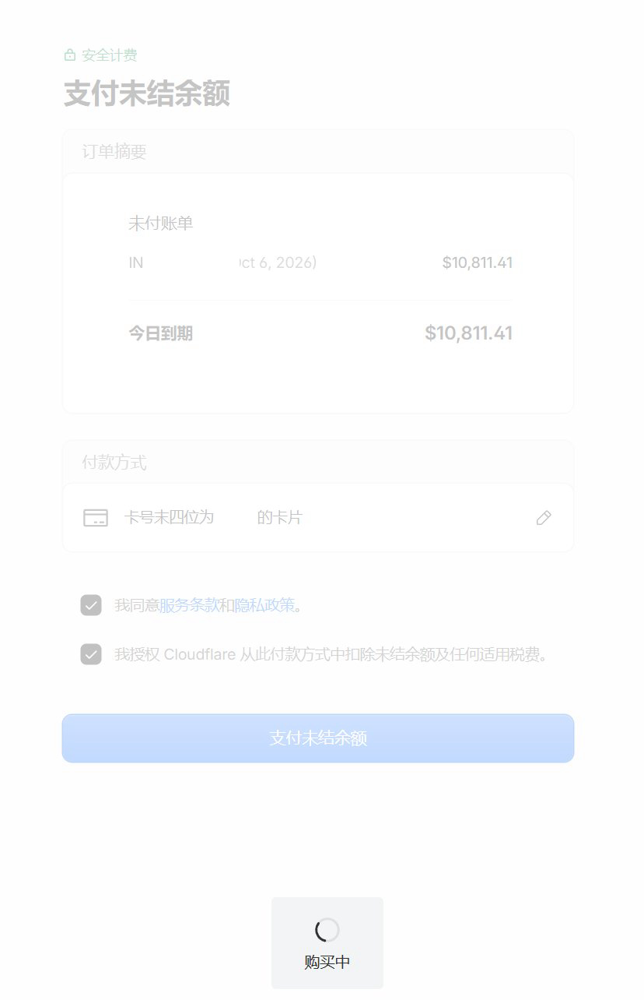

# Um alarme de Durable Object de US$ 10.811

2026-10-10&emsp;Incidente&emsp;<a href="./">Todos os posts</a>

Em 6 de outubro, um desenvolvedor que publica como [浮世绘 (@shmily7)](https://x.com/shmily7) compartilhou uma fatura da Cloudflare de **US$ 10.811,41**. A causa, nas palavras dele: um alarme de Durable Object preso em um loop infinito, girando cerca de seis trilhões de leituras e escritas. O projeto em si era apenas um protótipo de pesquisa parado que ninguém usava. [A thread](https://x.com/shmily7/status/2108060782302990699) teve centenas de milhares de visualizações, e não poucos desenvolvedores foram discretamente conferir os próprios painéis.

A fatura, como publicada por <a href="https://x.com/shmily7">@shmily7</a>, com os detalhes de faturamento desfocados pelo próprio autor.

A história terminou bem, então essa parte primeiro: a Cloudflare concordou em reembolsar as cobranças. Ainda assim, o modo como aconteceu é comum o bastante para valer a pena ser desmontado.

## O que aconteceu

- **O bug ficou 23 dias no ar.** Entrou durante o desenvolvimento e ficou parado, até que o alarme começou a reagendar a si mesmo. Como nada falhava, não havia erro nem aviso: cada execução tinha sucesso e era faturada.
- **A fatura foi o primeiro sinal.** A Cloudflare a emitiu em 6 de outubro, com vencimento no mesmo dia.
- **Eles pagaram.** Um pedido de suporte por uma isenção única esbarrou em respostas automáticas, e e-mails avisando que os serviços da conta seriam suspensos continuavam chegando, então em 8 de outubro eles pagaram integralmente. Questionados nas respostas por que não simplesmente abandonavam, responderam (na nossa tradução): *você comete um erro, assume — encara o prejuízo de pé.*
- **Então a Cloudflare interveio.** Ashley Peacock levou o caso internamente, o CTO da Cloudflare o escalou, e em 9 de outubro a Cloudflare decidiu reembolsar tudo o que foi cobrado durante o bug, acompanhado de um relato detalhado do que deu errado.

{.portrait}

Pagando o saldo em 8 de outubro. Publicado por <a href="https://x.com/shmily7">@shmily7</a>; removemos o número da fatura e os quatro últimos dígitos do cartão.

Eles não estavam sozinhos. Outros desenvolvedores nas respostas mencionaram faturas entre US$ 1.000 e US$ 10.000, cada uma provocada por um loop ou uma rotina de polling que passou despercebido.

## Por que nada avisou ninguém

Três coisas se alinharam aqui.

**A cobrança não tem freio.** Em um plano pago, um Durable Object cobra por requisição, por unidade de duração e por linha lida e escrita. Um loop não quebra; ele apenas continua cobrando, e nada interrompe uma conta pay-as-you-go ao atingir um limite de gasto. Uma das respostas observou que a Cloudflare anunciou limites de gasto, com um preview previsto para o fim do ano. Até isso chegar, o teto é o que o cartão conseguir autorizar.

**Um alarme pode agendar a si mesmo.** A forma padrão de tratar trabalho periódico em um Durable Object é um handler `alarm()` que executa sua tarefa e chama `setAlarm()` para a próxima execução. Se o cálculo desse próximo horário cair no passado ou no instante atual, o handler dispara de novo imediatamente e continua, lendo e escrevendo no armazenamento a cada passagem.

**Ninguém estava olhando.** Um projeto sem usuários não tem gráficos de tráfego que alguém confira nem logs de erro para revisar, e esse loop nunca lançou um erro. Sem olhos humanos sobre ele, um consumo alto nunca se transforma em aviso por conta própria.

As duas primeiras são da Cloudflare para mudar e do desenvolvedor para se proteger. A terceira é onde as ferramentas podem ajudar.

## O que um registro diário teria mostrado

O CloudBridge puxa o consumo faturável da Cloudflare todos os dias e, quando recebe Account Analytics no token, divide as linhas de Durable Objects entre namespaces. Vale ser preciso sobre o que isso teria e não teria feito neste caso.

- **Teria capturado o loop no dia seguinte.** As linhas lidas e escritas do namespace entram no registro diariamente, incluindo a parte coberta pela franquia gratuita a custo zero, que é onde um loop começa.
- **A regra de anomalia teria ficado em silêncio.** Ela avalia cada serviço contra os seus próprios sete dias anteriores, e um projeto que não custava nada tem uma linha de base zero. Evitamos de propósito sinalizar uma primeira aparição como “crescimento”: a maior parte do gasto novo é simplesmente uma carga de trabalho nova, não um descontrole. Aqui o resultado foi errado, e é uma lacuna conhecida na nossa lógica.
- **Uma regra de orçamento por previsão teria disparado na primeira atualização.** A previsão de fechamento do mês faz a média do gasto a partir do primeiro dia com cobranças, projetando essa taxa pelo restante do mês. Para pôr números nisso: um loop que fatura US$ 300 no primeiro dia, com 20 dias restantes, projeta mais de US$ 6.000. Contra um orçamento mensal modesto de US$ 20, essa regra dispara na primeira atualização que lê o dia.
- **Não teria parado nada.** O CloudBridge lê faturas com um token somente leitura. Ele não pode pausar um Worker, e não deveria ter esse poder. O que muda é a sua linha do tempo: você descobre dentro de um intervalo de atualização (de no mínimo seis horas) depois de a Cloudflare reportar o dia, em vez de esperar a fatura chegar.

A configuração leva cerca de um minuto por conta: defina um orçamento mensal, adicione uma regra Orçamento da conta baseada na previsão de fechamento do mês, escolha um intervalo de atualização de 6 horas e mantenha o aplicativo rodando na barra de menus. [Conter um descontrole](https://cloudbridge.jetsquirrel.cloud/docs/cloudflare#runaway) percorre os passos. Vale a pena fazer isso também para contas silenciosas, porque são justamente essas que ninguém está vigiando.

## Protegendo o próprio alarme

Um aviso encurta um descontrole; não o impede. Dentro do próprio Durable Object:

- **Rearme de propósito.** Faça `alarm()` chamar `setAlarm()` apenas quando houver mais trabalho a fazer, e calcule o próximo horário a partir de agora com um piso, para que nunca possa ser agendado no passado.
- **Conte as execuções.** Mantenha um contador no armazenamento por hora ou por dia. Quando ele passar de um teto que nenhuma carga de trabalho real deveria atingir, pare de rearmar e registre isso em alto e bom som.
- **Limpe alarmes quando ocioso.** Chame `deleteAlarm()` sempre que um objeto não tiver mais nada a fazer.
- **Derrube o que ninguém usa.** Um protótipo implantado continua atrelado a uma conta de faturamento ativa. Se ele não é necessário neste mês, exclua o Worker.

## O que vem a seguir

As notas de versão da 0.5.0 diziam que os achados da Cloudflare começariam por namespaces de Durable Object cujos objetos mantêm alarmes ativos. Este é exatamente o caso que isso deve capturar. O ponto cego da regra de anomalia para gasto que começa do zero é uma lacuna conhecida; até que seja fechada, a regra de orçamento cobre isso.

Agradecemos ao autor da thread por contar a história inteira em público, reembolso e tudo.
